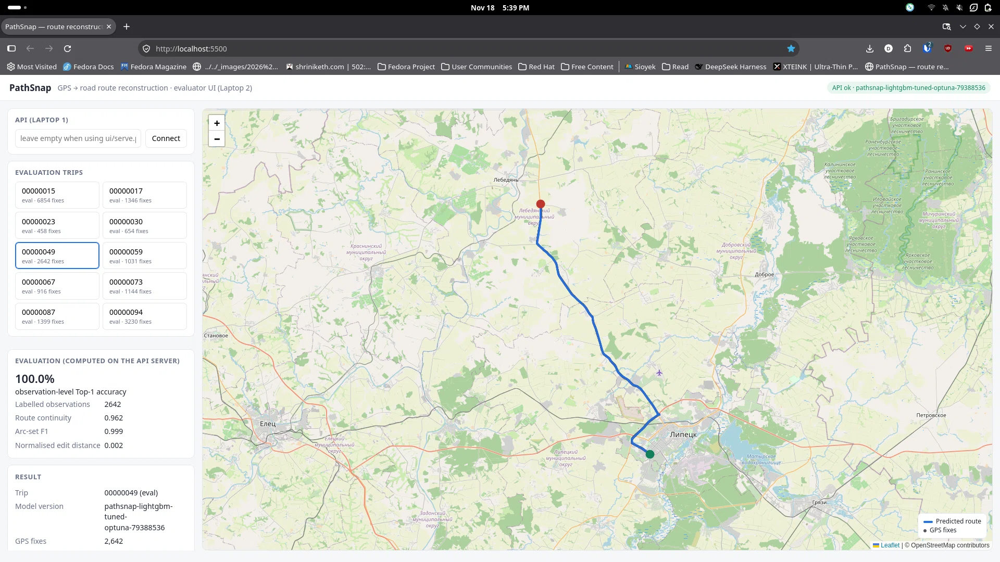
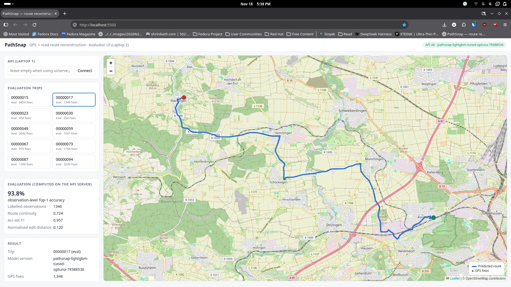
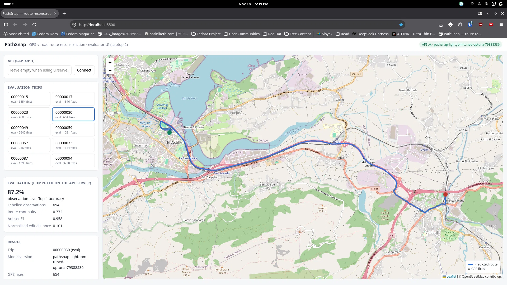
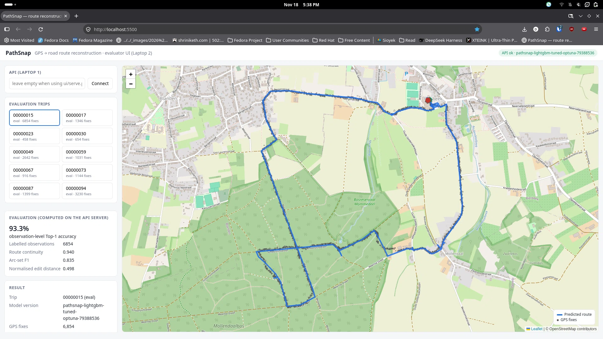

# PathSnap: distributed map-matching and route reconstruction

**UE24CS352A Machine Learning, PES University (RR Campus)**

| Member | SRN |
|---|---|
| Srihari Nagesh | PES1UG24CS445 |
| Shriniketh Kana | PES1UG24CS446 |
| Sukmeet | PES1UG24CS479 |
| Sujay Hegde | PES1UG24CS478 |

## 2.2 Dataset understanding and exploratory data analysis

The dataset is 90 independent trips, each shipped with its own local road network, and each from a different city. Four headerless files per trip:

| File | Columns | Meaning |
|---|---|---|
| `.track` | 3, float | longitude, latitude, timestamp in seconds |
| `.nodes` | 2, float | longitude, latitude; row index is the node id |
| `.arcs` | 2, int | from_node_id, to_node_id; row index is the arc id |
| `.route` | 1, int | arc ids traversed, in order |

Identifiers are trip-local, so an arc id means nothing outside its own trip. That single fact rules out classifying over arc ids and forces a pairwise model over (observation, candidate arc).

### Preprocessing

1. Parse and validate every file: column counts, integer ids, id ranges, timestamp ordering. 360 of 360 files pass.
2. Project each trip into its own equirectangular tangent plane, centred on the trip, so distances are metres. Haversine is kept as the reference and the projection is measured against it: worst per-trip error 0.583 percent, mean of the per-trip maxima 0.096 percent.
3. Build a directed graph per trip: CSR adjacency, arc lengths, bearings, connected components, and a spatial index over points sampled along each arc.
4. Derive per-observation reference labels with a monotone alignment against the ordered route, keeping route position so a revisited arc stays distinct.
5. Generate candidates, extract features, train.

### Coordinate order

The files have no headers. Eight trips carry a column 0 value above 90 degrees, the largest being 137.24, and column 1 never exceeds 61.70. A latitude cannot exceed 90, so column 0 is longitude. Reading the pair as `(lon, lat)` also puts fixes closer to their network on 90 of 90 trips.

### What the exploration found

| Finding | Value |
|---|---|
| GPS fixes | 227,577 |
| Road-network nodes / arcs | 2,024,174 / 4,061,945 |
| Fixes per trip | 262 to 19,313 |
| Median distance, fix to nearest road | 4.16 m |
| 95th percentile of that distance | 13.0 m |
| Steps exactly 1 s apart | 94.3 percent |
| Trips with a gap over 60 s | 23 (70 gaps, largest 153,064 s) |
| Median connected components per trip | 19 |
| Trips whose route has chain breaks | 11 |
| Trips whose route revisits an arc | 10 |

The noise figure is the one that motivates the whole approach. A median 4.2 m error is the same size as the gap between parallel carriageways, so distance alone cannot say which road the vehicle was on. Taking the single nearest arc lands on the reference route only about 80 percent of the time.

Missing values: zero non-finite values, zero decreasing timestamps, zero out-of-range coordinates. Five trips repeat a coordinate on consecutive fixes, which is a stationary vehicle rather than corruption. The data is irregular in time and noisy in space, not holey.

### Features extracted, and why

Twenty-one features in six groups, all relative to the road network. No absolute longitude or latitude anywhere, because the evaluator trips come from cities that are not in the training data.

| Group | Features | Why |
|---|---|---|
| geometry | dist_m, proj_t, end_dist_min_m, log_arc_len | distance is the main signal; position along the arc and proximity to a junction matter near intersections |
| ranking | dist_rank, dist_gap_to_best, dist_ratio_to_best, n_cands, n_close_cands | how much better this candidate is than the alternatives, and how crowded the area is |
| heading | cos_heading, heading_valid | the only feature that separates a two-way road's two arcs, which sit at identical distance |
| context | ctx_dist_mean, ctx_dist_max, ctx_gap_to_best | a real road fits the whole local track; a side street only touches it |
| network | from_in_deg, to_out_deg, has_reverse_twin, local_arc_density | junction complexity and whether the road is two-way |
| temporal | speed_mps, dt_prev_s, long_gap | guards against stopped vehicles, sub-second timestamps and the 60 s gaps |

Ablation, LightGBM on the first three folds:

| dropped_group | n_features | cv_macro_f1 | cv_top1 |
| --- | --- | --- | --- |
| none (all features) | 21 | 0.9086 | 0.7975 |
| geometry | 17 | 0.8957 | 0.7902 |
| ranking | 16 | 0.9069 | 0.7973 |
| heading | 19 | 0.7476 | 0.5390 |
| context | 18 | 0.9027 | 0.7880 |
| network | 17 | 0.9059 | 0.7954 |
| temporal | 18 | 0.9066 | 0.7949 |

Dropping heading costs about 0.26 CV Top-1 accuracy, far more than any other group. That is the expected result: two-way roads are stored as two arcs at the same distance, and direction of travel is the only thing that tells them apart.

### Visualisations

| Figure | File |
|---|---|
| Dataset inventory by partition | `results/figures/eda/01_inventory.png` |
| Trip size distributions | `results/figures/eda/02_trip_sizes.png` |
| Sampling intervals | `results/figures/eda/03_sampling_intervals.png` |
| Largest gap per trip | `results/figures/eda/04_gaps.png` |
| Fix to nearest road distance | `results/figures/eda/05_gps_to_road_distance.png` |
| Trip locations worldwide | `results/figures/eda/06_trip_locations.png` |
| Network connectivity | `results/figures/eda/07_network_connectivity.png` |
| Route length against GPS count | `results/figures/eda/08_route_vs_track.png` |
| GPS track over road geometry | `results/figures/eda/09_track_vs_network.png` |
| Coordinate order proof | `results/figures/eda/10_coordinate_order.png` |
| Trajectory extent | `results/figures/eda/11_trajectory_extent.png` |
| Projection error per trip | `results/figures/eda/12_projection_error.png` |
| Coordinate distributions | `results/figures/eda/13_coordinate_distributions.png` |

All thirteen are computed from all 90 supplied trips. The full data-quality record, including assumptions and open questions, is in `docs/DATA_NOTES.md`.

## 3. Model experimentation and comparison

Eight models across seven algorithm families, all trained on the same 21 features with the same row order, the same five GroupKFold folds by trip, and standardisation fitted inside each training fold only.

### 3.1 Overall comparison

| Model | Family | CV MacF1 | Top-1 | Cont. | Test MacF1 | LogLoss |
| --- | --- | --- | --- | --- | --- | --- |
| NearestArc_baseline | Rule | 0.750 | 0.541 | 0.421 | 0.776 |  |
| LogisticRegression | Linear | 0.874 | 0.854 | 0.732 | 0.907 | 0.092 |
| GaussianNB | Generative | 0.660 | 0.829 | 0.690 | 0.661 | 1.076 |
| KNN | Instance | 0.875 | 0.830 | 0.692 | 0.892 | 0.102 |
| DecisionTree | Tree | 0.899 | 0.881 | 0.796 | 0.932 | 0.059 |
| RandomForest | Bagging | 0.908 | 0.885 | 0.804 | 0.931 | 0.054 |
| HistGradientBoosting | Boosting | 0.902 | 0.881 | 0.751 | 0.931 | 0.067 |
| LightGBM | Boosting | 0.914 | 0.896 | 0.828 | 0.936 | 0.049 |
| MLP | Neural | 0.908 | 0.881 | 0.799 | 0.931 | 0.057 |

| Model | Key configuration | Inference time |
| --- | --- | --- |
| NearestArc_baseline | closest candidate wins | 0.00 ms / 1k candidates |
| LogisticRegression | C=1.0, lbfgs, standardised | 0.05 ms / 1k candidates |
| GaussianNB | var_smoothing=1e-9, standardised | 0.13 ms / 1k candidates |
| KNN | k=25, distance-weighted, standardised, <=80k fit rows | 118.41 ms / 1k candidates |
| DecisionTree | max_depth=12, min_samples_leaf=50 | 0.05 ms / 1k candidates |
| RandomForest | 100 trees, max_depth=18, min_samples_leaf=20, 50% bootstrap | 2.83 ms / 1k candidates |
| HistGradientBoosting | 200 iters, lr=0.1, 31 leaves | 2.40 ms / 1k candidates |
| LightGBM | 400 trees, lr=0.05, 63 leaves, 80% row/90% col subsample | 7.72 ms / 1k candidates |
| MLP | 64-32 ReLU, Adam, batch 1024, early stopping | 0.25 ms / 1k candidates |

The nine required columns are spread over these two tables: model, family, configuration, CV Macro F1, Top-1, route continuity, student-test Macro F1, log loss and inference time. They are split only so the table fits on the page.
Nearest-arc has no log loss because it produces no probability, only a ranking. Every Top-1 figure is on the 10 student-test trips, which are never used to fit or select anything.

**Selection rule, fixed before the results were seen:** highest mean CV Macro F1, with mean CV Log Loss breaking ties. Macro F1 rather than accuracy because the positive class is 9.3 percent of candidate rows; log loss as tie-break because the decoder consumes a probability itself.

### 3.2 Per-model answers

#### LogisticRegression

**A1. Why this algorithm suits PathSnap.** The task reduces to a yes/no decision per candidate, and a linear model on a standardised feature vector is the cheapest way to ask whether the features are additive in log-odds at all. It also gives a properly normalised probability, which the decoder needs.

**A2. Strengths and limitations.** Fast to fit, calibrated by construction, coefficients can be read as effect sizes. Any signal it finds is genuinely linear, so it sets a floor. Cannot express the interaction that matters here: a candidate that is close but pointing the wrong way should be rejected, which is a product of distance and heading, not a sum.

**B5. Important hyperparameters.** `C=1.0, lbfgs, standardised`. Chosen on the training folds; the full configuration and seed are in `experiments/*_LogisticRegression.json`.

**B6. Loss function or objective.** Binary cross-entropy (log loss), L2-regularised, lbfgs solver.

**C7. Performance on the student-testing set.** Top-1 accuracy 0.8540, Macro F1 0.9071, precision 0.8477, recall 0.8132, route continuity 0.7323.

**C8. Observation-level Top-1, Macro F1 and Log Loss.** Top-1 0.8540, Macro F1 0.9071, Log Loss 0.0915.

**C9. Overfitting or underfitting.** Train-fold Macro F1 0.8886 against validation 0.8738, a gap of 0.0147, so underfitting: the training folds score only slightly above validation. Fold standard deviation is 0.0503.

#### GaussianNB

**A1. Why this algorithm suits PathSnap.** A generative baseline that assumes features are independent within each class. Included to test that assumption, not because it is expected to win.

**A2. Strengths and limitations.** Trains in milliseconds and needs almost no data per class. The independence assumption is badly violated: distance, distance rank and distance gap are three views of the same quantity, so their evidence is counted three times and the probabilities saturate. Visible in the log loss.

**B5. Important hyperparameters.** `var_smoothing=1e-9, standardised`. Chosen on the training folds; the full configuration and seed are in `experiments/*_GaussianNB.json`.

**B6. Loss function or objective.** Maximum likelihood under a per-feature Gaussian per class.

**C7. Performance on the student-testing set.** Top-1 accuracy 0.8294, Macro F1 0.6612, precision 0.2933, recall 0.9786, route continuity 0.6904.

**C8. Observation-level Top-1, Macro F1 and Log Loss.** Top-1 0.8294, Macro F1 0.6612, Log Loss 1.0760.

**C9. Overfitting or underfitting.** Train-fold Macro F1 0.6597 against validation 0.6597, a gap of 0.0000, so underfitting: the training folds score only slightly above validation. Fold standard deviation is 0.0331.

#### KNN

**A1. Why this algorithm suits PathSnap.** Map matching is a local decision: two fixes 5 m apart on the same road should look alike. A nearest-neighbour vote on the candidate feature vector tests whether similarity in feature space carries the label.

**A2. Strengths and limitations.** No training step, naturally non-linear, easy to explain to a reader. Inference cost grows with the training set, so it was capped at 80k rows. It also cannot extrapolate: a candidate unlike anything in training falls back to whatever neighbour happens to be closest.

**B5. Important hyperparameters.** `k=25, distance-weighted, standardised, <=80k fit rows`. Chosen on the training folds; the full configuration and seed are in `experiments/*_KNN.json`.

**B6. Loss function or objective.** Distance-weighted majority vote over the 25 nearest training rows.

**C7. Performance on the student-testing set.** Top-1 accuracy 0.8301, Macro F1 0.8920, precision 0.8542, recall 0.7554, route continuity 0.6920.

**C8. Observation-level Top-1, Macro F1 and Log Loss.** Top-1 0.8301, Macro F1 0.8920, Log Loss 0.1018.

**C9. Overfitting or underfitting.** Train-fold Macro F1 0.9246 against validation 0.8747, a gap of 0.0499, so some overfitting: the training folds score clearly above validation, which is expected for a flexible model and is why the fold spread is reported. Fold standard deviation is 0.0393.

#### DecisionTree

**A1. Why this algorithm suits PathSnap.** A single tree shows which thresholds the data actually supports, and the tree depth that stops helping. Useful as a readable model before moving to ensembles.

**A2. Strengths and limitations.** Interpretable, handles mixed scales without standardisation, fast. High variance: a small change in the training trips redraws the splits. Depth was capped to control this, which costs some accuracy.

**B5. Important hyperparameters.** `max_depth=12, min_samples_leaf=50`. Chosen on the training folds; the full configuration and seed are in `experiments/*_DecisionTree.json`.

**B6. Loss function or objective.** Gini impurity, max_depth 12, min_samples_leaf 50.

**C7. Performance on the student-testing set.** Top-1 accuracy 0.8808, Macro F1 0.9319, precision 0.8811, recall 0.8704, route continuity 0.7962.

**C8. Observation-level Top-1, Macro F1 and Log Loss.** Top-1 0.8808, Macro F1 0.9319, Log Loss 0.0593.

**C9. Overfitting or underfitting.** Train-fold Macro F1 0.9410 against validation 0.8987, a gap of 0.0424, so some overfitting: the training folds score clearly above validation, which is expected for a flexible model and is why the fold spread is reported. Fold standard deviation is 0.0575.

#### RandomForest

**A1. Why this algorithm suits PathSnap.** Averaging many de-correlated trees addresses the variance problem seen in the single tree without giving up non-linearity.

**A2. Strengths and limitations.** Stable across folds, no scaling needed, gives a usable probability from the vote share. Large and slow at inference compared with boosting, and the vote share is less sharp than a boosted model's probability.

**B5. Important hyperparameters.** `100 trees, max_depth=18, min_samples_leaf=20, 50% bootstrap`. Chosen on the training folds; the full configuration and seed are in `experiments/*_RandomForest.json`.

**B6. Loss function or objective.** Gini impurity, 100 trees, 50 percent bootstrap sample per tree.

**C7. Performance on the student-testing set.** Top-1 accuracy 0.8852, Macro F1 0.9312, precision 0.9127, recall 0.8386, route continuity 0.8044.

**C8. Observation-level Top-1, Macro F1 and Log Loss.** Top-1 0.8852, Macro F1 0.9312, Log Loss 0.0537.

**C9. Overfitting or underfitting.** Train-fold Macro F1 0.9432 against validation 0.9081, a gap of 0.0350, so some overfitting: the training folds score clearly above validation, which is expected for a flexible model and is why the fold spread is reported. Fold standard deviation is 0.0384.

#### HistGradientBoosting

**A1. Why this algorithm suits PathSnap.** Boosting corrects the errors of the previous trees in sequence, which suits a problem where most candidates are easy and a small ambiguous minority decides the score.

**A2. Strengths and limitations.** Fast, handles the 21 features with no preprocessing, strong on tabular data. Fixed binning and a fixed leaf budget limit fine-grained splits on the distance feature, where the useful resolution is a metre.

**B5. Important hyperparameters.** `200 iters, lr=0.1, 31 leaves`. Chosen on the training folds; the full configuration and seed are in `experiments/*_HistGradientBoosting.json`.

**B6. Loss function or objective.** Binary log loss, 200 iterations, learning rate 0.1.

**C7. Performance on the student-testing set.** Top-1 accuracy 0.8809, Macro F1 0.9306, precision 0.8761, recall 0.8707, route continuity 0.7508.

**C8. Observation-level Top-1, Macro F1 and Log Loss.** Top-1 0.8809, Macro F1 0.9306, Log Loss 0.0668.

**C9. Overfitting or underfitting.** Train-fold Macro F1 0.9484 against validation 0.9022, a gap of 0.0461, so some overfitting: the training folds score clearly above validation, which is expected for a flexible model and is why the fold spread is reported. Fold standard deviation is 0.0512.

#### LightGBM

**A1. Why this algorithm suits PathSnap.** Leaf-wise growth concentrates capacity on the hard candidates rather than splitting every branch evenly, and the histogram binning keeps it fast enough for an API that must answer in seconds.

**A2. Strengths and limitations.** Best CV Macro F1 and best log loss of the eight, small enough to ship, and exposes a probability the decoder can consume directly. Leaf-wise growth overfits quickly on small data, so depth, leaves and both subsampling rates had to be constrained. Needs a seed to be reproducible.

**B5. Important hyperparameters.** `400 trees, lr=0.05, 63 leaves, 80% row/90% col subsample`. Chosen on the training folds; the full configuration and seed are in `experiments/*_LightGBM.json`.

**B6. Loss function or objective.** Binary log loss, 400 trees, learning rate 0.05, 63 leaves.

**C7. Performance on the student-testing set.** Top-1 accuracy 0.8957, Macro F1 0.9363, precision 0.9003, recall 0.8674, route continuity 0.8275.

**C8. Observation-level Top-1, Macro F1 and Log Loss.** Top-1 0.8957, Macro F1 0.9363, Log Loss 0.0487.

**C9. Overfitting or underfitting.** Train-fold Macro F1 0.9714 against validation 0.9141, a gap of 0.0573, so some overfitting: the training folds score clearly above validation, which is expected for a flexible model and is why the fold spread is reported. Fold standard deviation is 0.0371.

#### MLP

**A1. Why this algorithm suits PathSnap.** The relationship between distance, heading and correctness is plausibly non-linear and interacting, which is what a small network represents.

**A2. Strengths and limitations.** Learns interactions directly and beats the linear model by a wide margin. Sensitive to feature scaling and seed, slower per fold, and the probability is less well behaved than a tree ensemble's on unseen cities.

**B5. Important hyperparameters.** `64-32 ReLU, Adam, batch 1024, early stopping`. Chosen on the training folds; the full configuration and seed are in `experiments/*_MLP.json`.

**B6. Loss function or objective.** Binary log loss, Adam, early stopping on an internal validation split.

**C7. Performance on the student-testing set.** Top-1 accuracy 0.8814, Macro F1 0.9306, precision 0.8927, recall 0.8544, route continuity 0.7986.

**C8. Observation-level Top-1, Macro F1 and Log Loss.** Top-1 0.8814, Macro F1 0.9306, Log Loss 0.0567.

**C9. Overfitting or underfitting.** Train-fold Macro F1 0.9377 against validation 0.9081, a gap of 0.0296, so underfitting: the training folds score only slightly above validation. Fold standard deviation is 0.0373.

### 3.3 Model visualisations

| Figure | What it shows | File |
|---|---|---|
| CV Macro F1 with fold spread | all models, 5-fold grouped by trip | `results/figures/models/cv_macro_f1.png` |
| Student-test Macro F1 against Top-1 | all models | `results/figures/models/student_test_scatter.png` |
| Train against validation Macro F1 | overfitting evidence per model | `results/figures/models/train_vs_val.png` |
| Confusion matrices | all models, student test, threshold 0.5 | `results/figures/models/confusion_matrices.png` |
| Feature-group ablation | LightGBM, first three folds | `results/figures/models/feature_ablation.png` |
| Permutation importance | selected model, fold-0 validation | `results/figures/models/permutation_importance.png` |
| LightGBM log loss per iteration | training history, real curve | `results/figures/models/lightgbm_logloss_curve.png` |
| MLP training curve | loss and validation accuracy per epoch | `results/figures/models/mlp_training_curve.png` |

Only LightGBM and the MLP produce epoch-wise histories, so only those two have training curves. The other six are fitted in one step and have no curve to plot.

Top permutation importance, selected model on fold-0 validation:

| feature | importance_mean | importance_std |
| --- | --- | --- |
| cos_heading | 0.1952 | 0.0030 |
| ctx_gap_to_best | 0.1160 | 0.0017 |
| proj_t | 0.0953 | 0.0023 |
| has_reverse_twin | 0.0455 | 0.0014 |
| dist_gap_to_best | 0.0282 | 0.0011 |
| speed_mps | 0.0160 | 0.0006 |

## 4. Bayesian hyperparameter optimisation

**1. Hyperparameters in the search.** Seven: `num_leaves`, `learning_rate`, `n_estimators`, `min_child_samples`, `subsample`, `colsample_bytree`, `reg_lambda`.

**2. Ranges and distributions.**

| Parameter | Range | Why |
|---|---|---|
| num_leaves | 15 to 255, log | tree complexity; the untuned value was 63 |
| learning_rate | 0.01 to 0.2, log | step size, traded against the number of trees |
| n_estimators | 100 to 800, step 50 | boosting rounds |
| min_child_samples | 10 to 300, log | rows per leaf; larger smooths the fit |
| subsample | 0.5 to 1.0 | row bagging per tree |
| colsample_bytree | 0.5 to 1.0 | feature bagging per tree |
| reg_lambda | 1e-3 to 10, log | L2 penalty on leaf values |

**3. Objective function.** Mean Macro F1 over 3-fold GroupKFold by trip, on every eighth fix of the 80 training trips. Macro F1 is the same criterion used to select the model, and grouping by trip keeps whole cities out of the training side of each fold.

**4. Trials.** 29 trials requested, 16 completed and 13 pruned by a MedianPruner after five startup trials. Wall clock 407 s. The untuned configuration was enqueued as trial 0, so tuned and untuned were scored on identical folds.

**5. Best values.**

| Parameter | Value |
|---|---|
| num_leaves | 54 |
| learning_rate | 0.0198352 |
| n_estimators | 400 |
| min_child_samples | 27 |
| subsample | 0.535514 |
| colsample_bytree | 0.679228 |
| reg_lambda | 1.40951 |

**6. Did the tuned model outperform the untuned one?** Marginally on the selection criterion, and not on everything else.

| Model | CV Macro F1 | CV Top-1 | CV Log Loss | Student-Test Top-1 Accuracy | Student-Test Macro F1 | Student-Test Log Loss | Inference Time (ms / 1k candidates) |
| --- | --- | --- | --- | --- | --- | --- | --- |
| LightGBM untuned | 0.9141 | 0.8127 | 0.0885 | 0.8957 | 0.9363 | 0.0487 | 7.8282 |
| LightGBM tuned (Optuna) | 0.9145 | 0.8144 | 0.0839 | 0.8919 | 0.9372 | 0.0488 | 8.4630 |

CV Macro F1 rises from 0.91410 to 0.91454, a gain of 0.0004. Student-test Top-1 falls from 0.8957 to 0.8919 and student-test log loss rises from 0.0487 to 0.0488, while student-test Macro F1 rises from 0.9363 to 0.9372. Inference cost goes from 7.83 to 8.46 ms per thousand candidates. The tuning is close to a wash. The untuned configuration was already reasonable and the search spent much of its budget on a 3-fold objective that is itself noisy.

Tuning figures: `results/figures/hpo/optimisation_history.png`, `param_importance.png`, `untuned_vs_tuned.png`.

## 5. HMM and Viterbi route reconstruction

**1. Hidden states.** At fix *i*, the state is one of that fix's candidate arcs. A path through the trellis picks exactly one arc per fix.

**2. Emission probabilities.** `emission_weight * log p(arc | fix)` from the LightGBM positive-class probability, optionally plus a Gaussian distance term `-distance_weight * 0.5 * (d / sigma)^2`. The distance term defaults to off because the classifier already uses distance as its main feature.

**3. Transition probabilities.** Newson and Krumm's model: `-|route_distance - straight_line_distance| / beta`. The route distance is the driving distance between the two matched positions, computed as the remainder of the first arc plus a bounded Dijkstra path plus the head of the second arc. A pair with no path inside `route_factor * straight + route_slack` gets a transition of minus infinity.

**4. Missing candidates and large gaps.** A fix with no candidates ends the current chain, and the next fix starts a new one. A time gap over 60 s also starts a new chain, so no impossible transition is ever forced across the 42-hour gap in trip 00000090.

**5. Disconnected segments.** If every transition from the previous fix is impossible, the chain restarts at the current fix and the position is recorded in `break_indices`. The counts appear in the response diagnostics as `gap_breaks` and `impossible_transition_breaks`.

**6. Did decoding improve the route?** Yes, on every metric and on every one of the ten student-test trips.

| method | top1_acc | continuity | arc_set_f1 | norm_edit_distance | joined_route_continuity | joined_arc_set_f1 |
| --- | --- | --- | --- | --- | --- | --- |
| nearest | 0.5412 | 0.4207 | 0.5793 | 0.6672 |  |  |
| classifier | 0.8919 | 0.8257 | 0.8978 | 0.3510 |  |  |
| classifier+hmm | 0.9391 | 0.9154 | 0.9355 | 0.1436 | 1.0000 | 0.9775 |
| nearest+hmm | 0.9160 | 0.9135 | 0.9319 | 0.1636 | 1.0000 | 0.9692 |

Observation-level Top-1 rises from 0.8919 to 0.9391, route continuity from 0.826 to 0.915, arc-set F1 from 0.898 to 0.936, and normalised edit distance falls from 0.351 to 0.144. After joining non-touching consecutive arcs with shortest paths, continuity is 1.0 and edit distance 0.075.

Per-trip effect on the student-test set:

| trip_id | fixed_by_hmm | broken_by_hmm | labelled | net_gain |
| --- | --- | --- | --- | --- |
| 0 | 52 | 10 | 2503 | 42 |
| 7 | 55 | 2 | 1354 | 53 |
| 9 | 53 | 18 | 1049 | 35 |
| 40 | 76 | 38 | 2995 | 38 |
| 52 | 7 | 0 | 262 | 7 |
| 56 | 244 | 32 | 3955 | 212 |
| 65 | 31 | 24 | 768 | 7 |
| 76 | 79 | 17 | 1486 | 62 |
| 77 | 622 | 202 | 3911 | 420 |
| 91 | 40 | 12 | 874 | 28 |

Every trip gains more than it loses, but the losses are real: on trip 00000077 the decoder fixes 622 observations and breaks 202. Those are cases where a smooth, confidently-scored but wrong road won on transition cost, which is the failure mode to watch for. Worked examples are in `results/routes/examples.json`, with maps at `maps/hmm_improved_00000077.html` and `maps/hmm_hurt_00000077.html`.

Decoder settings were tuned on 24 training trips using out-of-fold scores only, with the objective being mean per-trip Top-1; student-test was never part of the tuning. The chosen values and the tuning set are recorded in `artifacts/models/final/decoder_config.json`.

## 6. Geographical visualisation with Folium

Interactive maps are generated by `scripts/eda.py` and by Member 3's route evaluation. Each has a layer control, a legend and a fixed title bar naming the trip and partition:

| Map | Layers | File |
|---|---|---|
| Dense network, trip 00000013 | road network (sampled), GPS fixes | `maps/eda_dense_network.html` |
| Sparse network, trip 00000046 | road network (sampled), GPS fixes | `maps/eda_sparse_network.html` |
| Offset trip, 00000054 | road network (sampled), GPS fixes | `maps/eda_offset_trip.html` |
| HMM improvement, trip 00000077 | GPS, predicted route, reference | `maps/hmm_improved_00000077.html` |
| HMM regression, trip 00000077 | GPS, predicted route, reference | `maps/hmm_hurt_00000077.html` |

Static captures are in `results/figures/maps/`. The base layer is Esri World Street Map because OpenStreetMap returns HTTP 403 to automated tile requests; the geometry layers are drawn by Leaflet regardless, so a map still reads if tiles fail.

The evaluator-facing UI draws the same layers for the trip it is asked about: GPS fixes in grey, the predicted route in blue, with a legend and pan/zoom.

## 7. API, UI and deployment

Laptop 1 runs the FastAPI service, which holds the model, the decoder, the road networks and the scoring. Laptop 2 runs the UI and holds nothing.

| Endpoint | Purpose |
|---|---|
| `GET /api/health` | status, model version, git commit, trips available |
| `GET /api/trips` | the evaluation trips on the server |
| `POST /api/predict` | `{trip_id}` in, predicted route plus server-side metrics out |
| `GET /api/model` | selected model, decoder settings, saved evaluation summary |

Ground truth never leaves Laptop 1. The prediction pipeline reads only `.track`, `.nodes` and `.arcs`; the reference route is opened afterwards, inside the scoring function, and only the resulting numbers are returned. `scripts/check_pipeline.py` verifies this by producing an identical prediction with and without a `.route` file present, and by checking that no module on the prediction path imports the labels.

### Working UI

The screenshots below are the running UI on Laptop 2 taking predictions from the API on Laptop 1, each showing one evaluator trip with the accuracy the server computed for it. The trip list, the model version and the latency are returned by the API; the UI holds neither the model nor the reference routes.

Evaluator trip 00000049, the strongest trip, 100 percent Top-1 on 2,642 fixes.

Evaluator trip 00000017, a long highway trip, 93.8 percent on 1,346 fixes.

Evaluator trip 00000030, the weakest trip, 87.2 percent on 654 fixes.

Evaluator trip 00000015, the largest trip, 93.3 percent on 6,854 fixes.

The remaining six evaluator trips were run the same way; their scores are in the table below, and every screenshot is in `report/figures/ui/`.

### Final evaluation on the withheld evaluator trips

The ten evaluator trips were placed in `data/eval/` on Laptop 1 and run through the same pipeline, with no retraining and no adjustment.

| trip_id | fixes | breaks | observation_top1_accuracy | route_continuity | arc_set_f1 | normalized_edit_distance | latency_ms |
| --- | --- | --- | --- | --- | --- | --- | --- |
| 15.0000 | 6854.0000 | 0.0000 | 0.9329 | 0.9398 | 0.8349 | 0.4981 | 3715.9028 |
| 17.0000 | 1346.0000 | 0.0000 | 0.9376 | 0.7236 | 0.9572 | 0.1196 | 1241.5973 |
| 23.0000 | 458.0000 | 0.0000 | 0.9629 | 0.9180 | 0.9440 | 0.1449 | 375.9422 |
| 30.0000 | 654.0000 | 0.0000 | 0.8716 | 0.7715 | 0.9579 | 0.1008 | 575.7341 |
| 49.0000 | 2642.0000 | 0.0000 | 0.9996 | 0.9618 | 0.9988 | 0.0024 | 1463.7396 |
| 59.0000 | 1031.0000 | 0.0000 | 0.9719 | 0.7978 | 0.9753 | 0.0789 | 821.7397 |
| 67.0000 | 916.0000 | 0.0000 | 0.9607 | 0.8933 | 0.9878 | 0.0357 | 468.6415 |
| 73.0000 | 1144.0000 | 3.0000 | 0.9851 | 0.9528 | 0.9958 | 0.0246 | 684.7706 |
| 87.0000 | 1399.0000 | 0.0000 | 0.9971 | 0.9704 | 0.9989 | 0.0022 | 941.9295 |
| 94.0000 | 3230.0000 | 0.0000 | 0.9517 | 0.8780 | 0.9781 | 0.1347 | 1948.5588 |

Across all 19,674 evaluator-test observations: weighted Top-1 accuracy 0.9549, mean per-trip Top-1 0.9571, mean route continuity 0.8807, mean arc-set F1 0.9629, mean normalised edit distance 0.1142. Slowest trip 3.7 s end to end.

Trip 00000015 is the weak case: Top-1 is 0.933 but arc-set F1 is 0.835 and edit distance 0.498, which means the right arcs were mostly found but the returned sequence carried extra or missing arcs. That points at route assembly rather than classification.

## 8. Academic integrity and AI use

Every result in this report is produced by code in the repository and can be regenerated from the commands in `README.md`. Numbers are read from the saved CSV, JSON and parquet outputs by `scripts/build_report.py`, so the report cannot state a figure that the experiments did not produce.

The four members divided the work as recorded in `docs/`: data engineering and labels (`DATA_NOTES.md`), candidates, features and model comparison (`MEMBER2_NOTES.md`), tuning, decoding and the pipeline (`MEMBER3_NOTES.md`), and the API and UI (`DEPLOYMENT.md`). Each member can explain their own modules and the interface contracts between them.

AI assistants were used during development for scaffolding, documentation review and code generation, under the disclosure terms of the event. Every generated result was re-run and checked against the saved outputs before being reported. The modelling choices, experiment design, evaluation protocol and interpretation are the team's.

